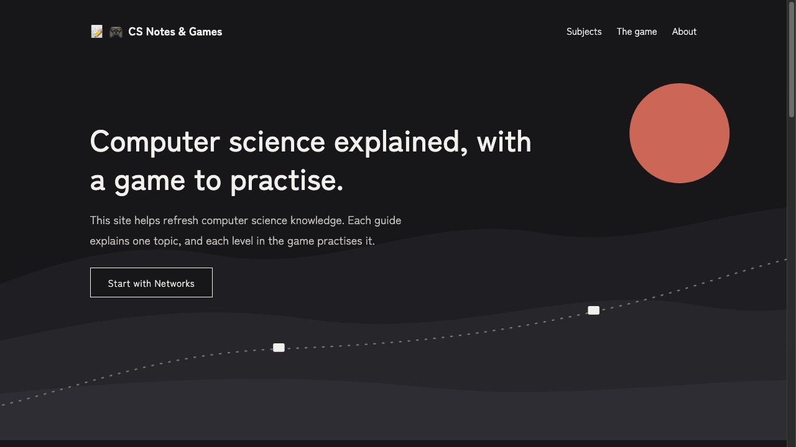
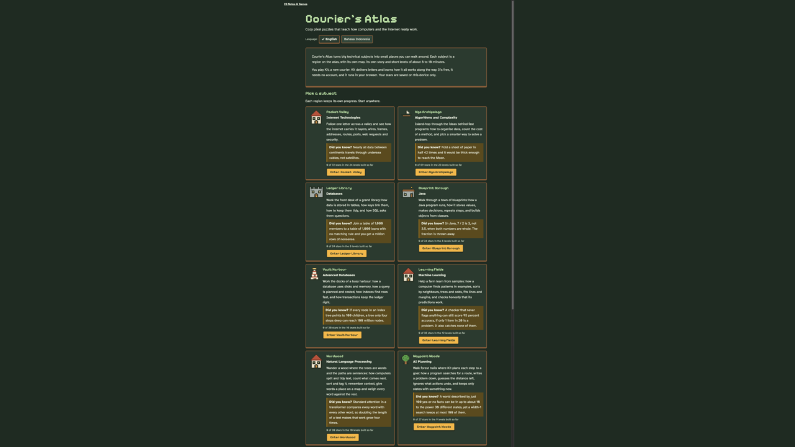

# CS Notes & Games

Computer science explained, with a game to practise.

This site helps refresh computer science knowledge. Each guide explains one topic, and each level in the game practises it.

**Live site: https://cesinata.github.io/cs-notes-and-games/**
**Play the game: https://cesinata.github.io/cs-notes-and-games/game/**

[](https://cesinata.github.io/cs-notes-and-games/)

[](https://cesinata.github.io/cs-notes-and-games/game/)

## What is here

- **The hub** (the pages at the root): plain-language guides, grouped by subject. Each guide starts from an everyday example, defines its terms, works through an example with labelled numbers, and ends with three check-yourself questions and a "Go deeper" section.
- **The game** (`game/`): Courier's Atlas, a puzzle game where you play a courier. Each of its eight regions matches a subject: Packet Valley (Networks), Algo Archipelago (Algorithms), Ledger Library (Databases), Blueprint Borough (Java), Vault Harbour (Advanced Databases), Learning Fields (Machine Learning), Wordwood (Natural Language Processing) and Waypoint Woods (AI Planning). About 100 levels are built so far, and more will be added. See [game/README.md](game/README.md).

Subjects: Networks, Algorithms, Databases, Java, Advanced Databases, Machine Learning, Natural Language Processing and AI Planning. The outline lists every planned chapter. Chapters that are not written yet show "Coming soon". Run the build to see how many are ready.

## Where things live

```
hub-src/              chapter sources and the site outline
hub/hub.css           hub styles
tools/build-hub.mjs   the builder
game/                 the game
docs/                 notes: architecture, voice, progress, game design
index.html, subjects/, about/, 404.html   generated hub pages
```

## Languages

English first. A casual Indonesian version is planned for the hub pages, then the game's level text. The game's interface already has English and Bahasa Indonesia.

## How this was made

Claude, Anthropic's AI assistant, wrote most of the code and the first drafts of the text, working from plans by the project owner, using claude.ai and Claude Code. The project owner plans the structure and decides what each topic covers.

Each chapter lists, in its front matter, the claims on the page and where to confirm them. Not every page has been fully checked yet.

This project is for people who find computer science hard to learn. Plain-language guides explain each topic, and a game makes practising easier and more fun. No course slides, exams, tutorial solutions or assignment material are included.

## Report a mistake

If something looks wrong, email cesilianata@gmail.com with the page name and what looks wrong.

## Licences and credits

Code: MIT. Written content: CC BY 4.0. See `LICENSE` and `CREDITS.md`. Third-party sources are linked from each page, not copied.

## Look at it locally

From the repo root:

```
python3 -m http.server 8000
```

Then open http://localhost:8000/ for the hub and http://localhost:8000/game/ for the game. Press Ctrl+C to stop.

## Build the hub pages

The hub pages are generated from Markdown by a script that needs Node 22 or newer and no packages.

```
node tools/build-hub.mjs --check    check the chapters; writes nothing
node tools/build-hub.mjs            check, then rebuild the pages
node game/tools/check-content.mjs   check the game's content files
```

The generated files are committed, because GitHub Pages serves them as they are. Edit the files in `hub-src/`, not the generated pages. [docs/hub-architecture.md](docs/hub-architecture.md) explains the layout and how to add a chapter, and [docs/voice-guide.md](docs/voice-guide.md) sets out how pages are written.
